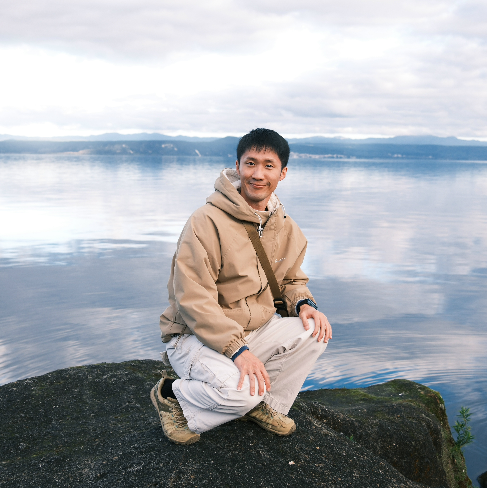
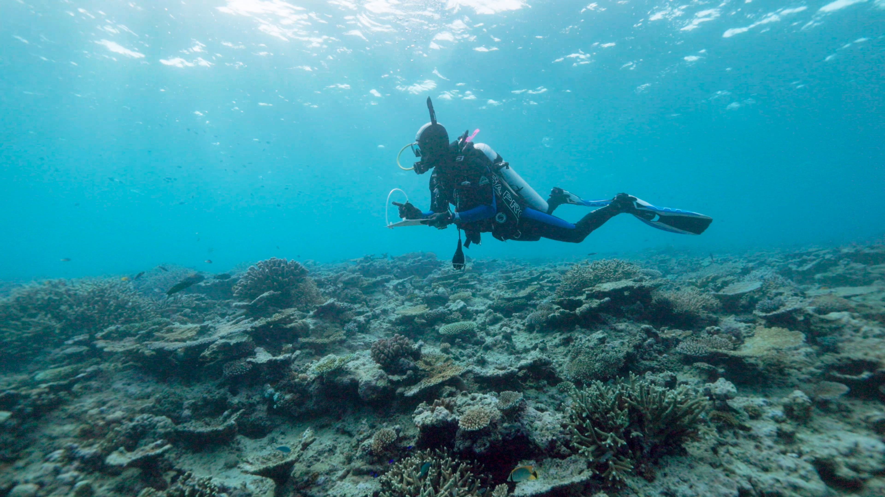

## About Me

::::: grid
::: {.g-col-12 .g-col-md-5}
{width="90%" style="border-radius: 8px; display: block;"}
:::

::: {.g-col-12 .g-col-md-7 style="display: flex; flex-direction: column; justify-content: space-between;"}
I am a marine ecologist holding a PhD from the University of Sydney, preparing to join the REEFS group at Lancaster University in February 2027 as a Senior Research Associate within the [BEACON](https://sallykeith.weebly.com/beacon-project.html) project. My research focuses on fish behaviour, ecological interactions, and ecosystem function across coral reefs and marine habitats. I integrate fish surveys (visual census, stereo-RUVs, and eDNA), benthic photogrammetry, and organismal trait assays (lipids, fatty acids, and stable isotopes) to investigate functional dynamics across spatial scales. I am always open to discussing new research collaborations and academic exchange. Feel free to reach out directly at [tony.tsaihsuan.hsu\@gmail.com](mailto:tony.tsaihsuan.hsu@gmail.com).
:::
:::::

## Some Fun Photos

### *Chaetodon rainfordi* (Rainford's butterflyfish) is such a fascinating species to center a PhD around!

### Conducting fish visual census on the southern GBR, Australia

### Photogrammetry-mapping at One Tree Island, southern GBR, Australia

